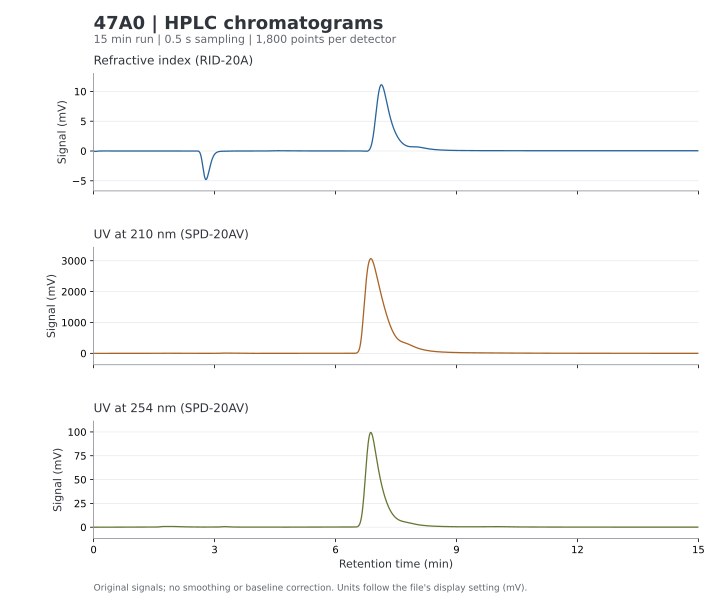
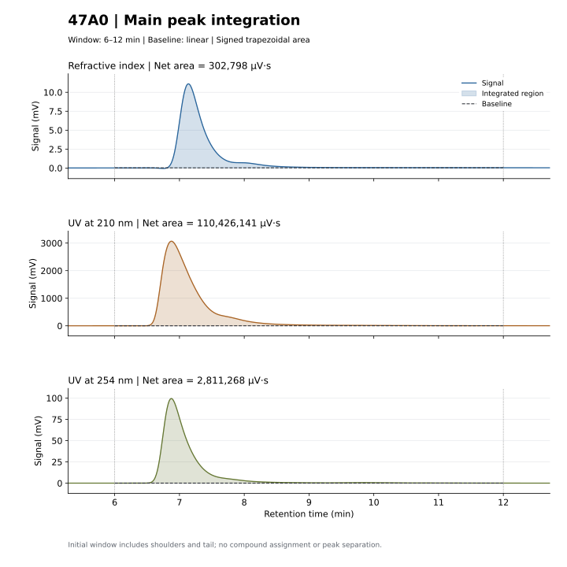

# HPLC analysis

Python tools for Shimadzu HPLC chromatogram extraction, visualization, and peak
areas in **µV·s**. The repository contains code and two demonstration SVGs.
Input data and generated CSV, JSON, PNG, PDF, and other figures stay local.

Requires Python 3.9+:

```powershell
python -m pip install -r requirements.txt
```

## Export saved Shimadzu areas from a folder

```powershell
python batch_extract_areas.py "C:\path\to\LCD folder" --output batch_results
```

The default large-peak filter keeps saved peaks with an apex in **6–12 min**,
area **≥1000 µV·s**, and area **≥1%** of the largest positive saved peak in
that window, separately for each file/detector. Both thresholds must pass.
The 1000 minimum matches the illustrated Shimadzu setting. The extra 1% rule
is a stricter reporting choice; that relative-area control is inactive in the
screenshot. Existing saved tables already exclude areas below 1000.

```powershell
python batch_extract_areas.py "C:\path\to\LCD folder" --min-area 1000 --min-relative-area-percent 1
```

Use `--min-relative-area-percent 0` to disable relative filtering. Thresholds
filter saved peak records; they do not rerun Chromatopac width/slope detection
or separate shoulders from a main peak. `integrate_peak.py` still integrates
the full selected signal window, including shoulders and tail.

This reads the vendor's saved `LSS Data Processing/PT-*` peak tables directly,
retaining their original area precision and integration bounds.

- `all_saved_peak_areas.csv`: every saved peak, with filename, detector,
  retention time, area (µV·s), height (µV), and integration start/end times.
- `large_peak_areas.csv`: only saved peaks passing the time/area filters, with
  the effective threshold and each retained peak's percent of the largest peak.
- `main_peak_areas.csv`: one row per file, with RI and 210/254 nm UV columns.
  For each detector, selects the largest positive saved area whose apex is in
  6–12 min and passing both area filters. `--start` and `--end` change the
  selection window, preserving the saved integration bounds. Candidate counts
  now report peaks passing all filters. Missing/rejected peaks are blank, with
  explicit statuses.
- `extraction_metadata.json`: source hashes, coverage, method, and errors.

Save changes in LabSolutions before exporting to capture updated integration
results. For the 47A0 demonstration, the saved RI area is 303175.434 µV·s.

## Extract and plot chromatograms

```powershell
python plot_hplc.py "C:\path\to\sample.lcd" --output output
```

Exports detector traces, raw counts, metadata, and PNG/PDF/SVG plots. This reader
supports the three-channel RI, 210 nm UV, and 254 nm UV layout used by 47A0.
Time uses the recorded sampling interval; mV scaling follows the file's stored
calibration and value factors. The plotting layout is configured for the
demonstration's 15 minute run.



## Calculate areas with adjustable bounds

```powershell
python integrate_peak.py "C:\path\to\sample.lcd" --start 6 --end 12
python integrate_peak.py "C:\path\to\sample.lcd" --channel uv210 --start 6.2 --end 11.5
python integrate_peak.py output\sample_chromatograms.csv --start 6 --end 12
```

Accepts compatible LCD files or the exported three-channel CSV. Supply an input
path; the optional default points to the author's local 47A0 data. Other options
are `--channel ri|uv210|uv254|all`, `--baseline linear|none`, and `--output PATH`.

The script uses signed trapezoidal integration with interpolated boundary
samples. Its default baseline joins signal values at the endpoints; negative
portions are retained without clipping or smoothing. `--baseline none` uses a
zero baseline. Outputs include raw, baseline, and net areas, pointwise curves,
provenance JSON, and shaded plots.

**Area (µV·s) = area (mV·min) × 60,000.** Older mV·min and mV·s fields are also
retained. The default 6–12 min window includes shoulders and tail. This calculated
area can differ from saved Shimadzu results because baseline and boundary rules
differ: 47A0's RI example gives about 302798 µV·s with these settings. Areas do
not establish compound identity or concentration without appropriate calibration.



## Checks and format references

```powershell
python -m unittest discover -s . -p "test_*.py" -v
```

Numerical tests use synthetic data. Optional source-consistency checks run only
when the original LCD or local exported fixtures are available.

Binary layout references:
[chromatograms](https://github.com/ethanbass/chromConverter/blob/master/R/read_shimadzu_lcd.R)
and [saved peak tables](https://github.com/ethanbass/chromConverter/blob/master/R/read_shimadzu_peaktable.R).
