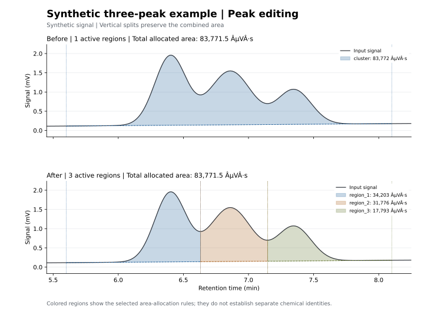

# HPLC analysis

Python tools for calibrated Shimadzu chromatograms, saved peak areas, acid-target
matching, and auditable manual peak editing. Areas are reported in **µV·s**.

Requires Python 3.9+:

```powershell
python -m pip install -r requirements.txt
```

## Interactive editor and component fitting

```powershell
python hplc_workbench.py
python hplc_workbench.py sample.lcd --channel ri
python fit_peaks.py --demo --output editing_results/overlap_demo
```

The local browser editor supports draggable baseline endpoints, window selection,
split/merge/skim/reject operations, undo/redo, session exports, and Gaussian/EMG
component-fit previews with residuals and diagnostic flags. Fitting supports
1–6 positive components with reviewed center estimates and a fixed baseline.
Window integrals and full model areas are reported separately. Model component
estimates do not establish chemical identity or unique separation of coelution.

- [Interactive workbench guide](docs/workbench.md)
- [Fitting API, CLI, assumptions, and uncertainty](docs/component_fitting.md)

## Manual peak editing

Split overlapping peaks, adjust baselines, insert/reject peaks, merge regions,
choose vertical or valley-baseline separation, allocate a rider peak with a
linear/custom skim, and undo/redo operations. Use the Python API or JSON recipes
for one trace or a folder of compatible LCDs.

```powershell
python edit_peaks.py --demo --output editing_results/demo
python edit_peaks.py sample.lcd --channel ri --recipe edits.json --output output
```

- [Editing API and allocation rules](docs/editing.md)
- [Recipe and batch examples](docs/editing_recipes.md)



Overlapping-component areas depend on the selected allocation rule. These tools
do not establish chemical identity or reproduce proprietary Chromatopac behavior.
The raw signal is retained; negative residuals are flagged instead of clipped.

## Extraction, integration, and targets

```powershell
python batch_extract_areas.py "C:\path\to\LCD folder" --output batch_results
python match_acid_peaks.py "C:\path\to\LCD folder" --targets targets.csv
python plot_hplc.py sample.lcd --output output
python integrate_peak.py sample.lcd --start 6 --end 12
```

- [Export exact saved Shimadzu peak tables](docs/batch_export.md)
- [Configure different acid/detector retention windows](docs/target_matching.md)
- [Plot raw traces and calculate window integrals](docs/integration.md)

The automatic reporting cutoff defaults to 5 min. Manual editing uses explicit
windows and does not silently discard early signal. The supplied LCD reader
supports RI plus UV at 210/254 nm; generic numeric CSV editing is also available.

## Checks and structure

```powershell
python check_module_sizes.py
python -m unittest discover -s . -p "test_*.py" -v
```

**Hard limit: 5,000 UTF-8 bytes per Python/JS/HTML/CSS module, test, and text document.**
The size check runs in the test suite and GitHub Actions. SVG demo assets are
exempt. LF line endings keep byte counts consistent across platforms.

Public commands stay at the repository root. Numeric I/O, filtering, reporting,
and target matching live in small `hplc/` modules; editing operations are grouped
by responsibility under `hplc/editing/`.

The repository contains code, documentation, and two SVG demos. LCD/CSV data,
JSON configurations/audits, and generated plots remain local and ignored by Git.
Optional source-consistency tests are skipped when local fixtures are absent.

Binary layout references: [chromatograms](https://github.com/ethanbass/chromConverter/blob/master/R/read_shimadzu_lcd.R)
and [saved peak tables](https://github.com/ethanbass/chromConverter/blob/master/R/read_shimadzu_peaktable.R).
